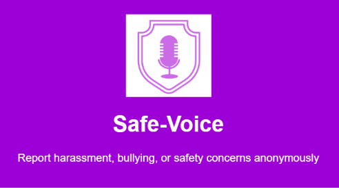

Students at the university often experience harassment, bullying, or safety concerns but hesitate to report them because of fear of stigma, retaliation, or not knowing who to approach. Current reporting relies on walking into the welfare office or informal word of mouth, which offers little privacy, no way to track progress, and no record of patterns across campus. This affects all students, particularly those in residences and those who study late. A web-based anonymous reporting system would let students submit concerns confidentially, follow the progress of their case using a private tracking code, and give the welfare office a dashboard to manage, prioritise, and resolve cases.
